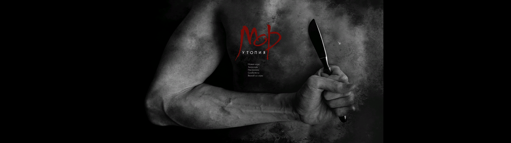
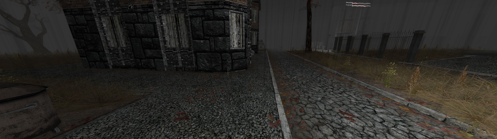
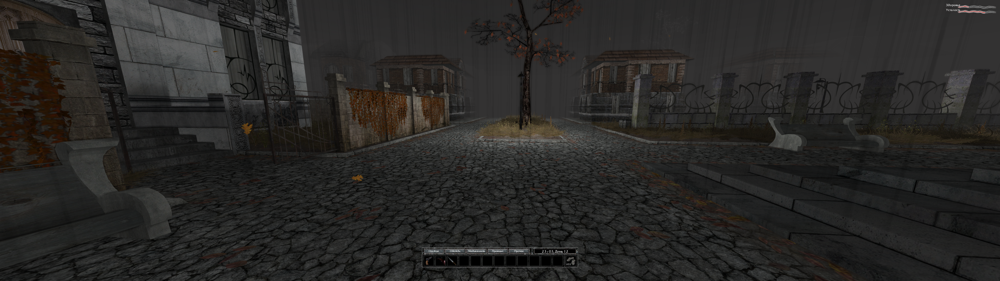
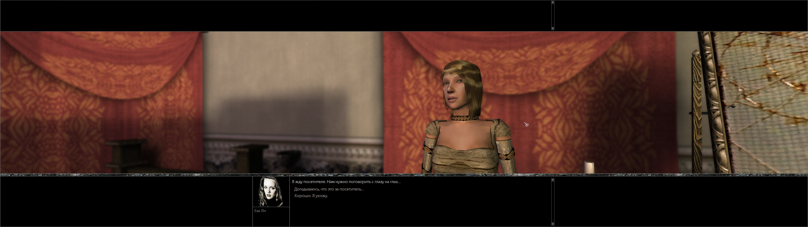
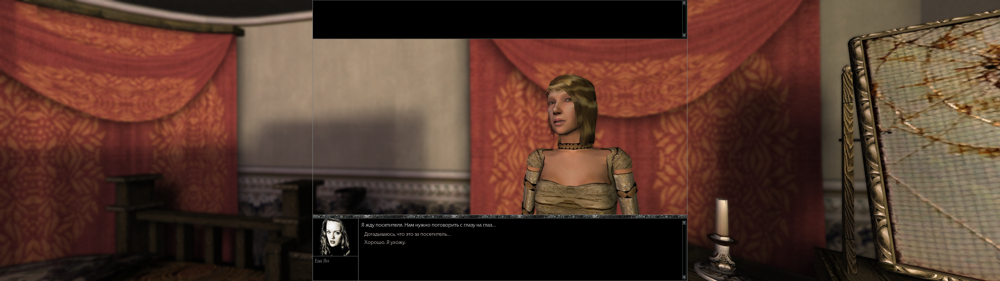
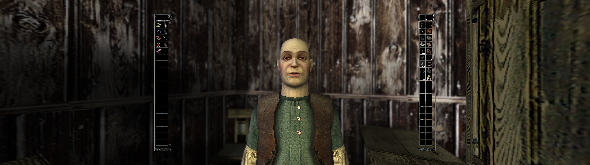
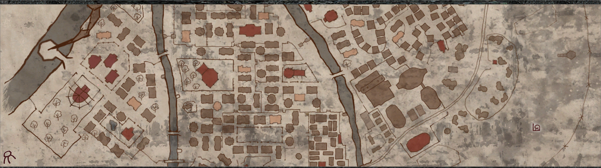
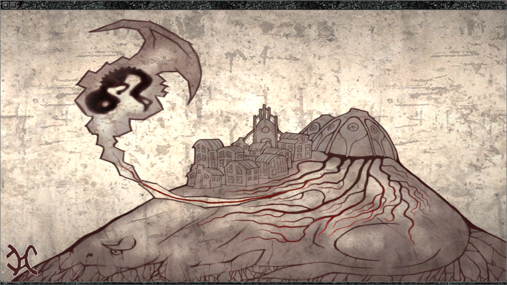

# Pathologic Classic HD — Custom Resolution UI Generator

**Open the Live Generator:** https://murzoned.github.io/pathologic-ultrawide-ui-generator/

A browser-based tool that generates native UI layouts and corrected loading screens for **Pathologic Classic HD** at any custom widescreen or ultrawide resolution (`21:9`, `32:9`, `16:10`, `48:9`, etc.) directly from your original game archives (`UI.vfs` and `Textures.vfs`).

* **100% Client-Side:** Archives are parsed locally in your browser via `File.slice()`. No game assets are stored in this repository or uploaded to any server.
* **No Third-Party Mod Dependencies:** Works directly with vanilla `UI.vfs` and `Textures.vfs` files.

## Features

* **Full XML Layout Adaptation:** Generates all resolution-dependent screen definitions (`<name>_<XRes>x<YRes>.xml`) from vanilla `1920×1080` or `1920×1200` templates (resolutions up to `1920×1200` are already built into the game).
* **Proper Aspect Ratio Handling:**
  * Main menu, character selection, and ending screens preserve their `16:9` artwork via extended UV coordinates (with an optional full-screen stretch toggle).
  * Inventory and bottom bars anchor cleanly without side texture artifacts.
  * Dialogs support both full-width cinematic letterbox bars and a compact centered window mode.
* **Ultrawide Map Zoom Fix (`width > 2048px`):** Caps the interactive town map canvas at `2044px` centered with black side borders to prevent wheel-zoom flickering caused by the engine's `2048px` render-target texture limit.
* **Ultrawide Loading Screen Fix:** Decodes `loading_ultrawide_bk01..07.tex` (DXT1 DDS) from `Textures.vfs` and pads them to match your exact aspect ratio so the engine does not crop them vertically on `21:9` and `32:9` displays.
* **Optional HUD Centering (32:9+):** Constrains status bars and notification icons to a central 16:9 safe zone instead of extreme screen edges.

## Screenshots (5120×1440 / 32:9)

**Main Menu (16:9 artwork preserved with pillarboxes)**


**Town Map (with `Fix map zoom glitch` enabled)**


**In-Game HUD (with `Center HUD elements` enabled)**


<details>
<summary>More layout &amp; option comparisons (Dialogs, Trade, Default HUD, Full-width Map)</summary>

**In-Game HUD (default corner anchoring)**


**Dialog Window (default full-width letterbox bars)**


**Dialog Window (with `Compact centered dialog window` enabled)**


**Trade / Inventory Screen**


**Town Map (without zoom fix — full width, prone to wheel-zoom flickering)**


</details>

<details>
<summary>Known Issue comparison: Tavro (Quest Map) crop on 32:9 vs 16:9</summary>

**Vanilla 16:9 (`1920×1080`) — full illustration visible**


**Ultrawide 32:9 (`5120×1440`) — left and right edges cropped by `ui_map.bin` scaling**


</details>

## Usage

1. Open the generator page (hosted via GitHub Pages or locally with `jszip.min.js` in the same folder).
2. Select a resolution preset or enter your custom **Width (`XRes`)** and **Height (`YRes`)** (must be greater than `1920×1200`).
3. Choose `UI.vfs` and `Textures.vfs` from your game's `data/` directory.
4. Click **Generate & Download ZIP**.

## Installation

1. Extract the downloaded `Pathologic_CustomUI_<W>x<H>.zip` directly into your game's `data/` folder so that `UI/` and `Textures/` sit alongside `UI.vfs` and `Textures.vfs`:
   ```text
   Pathologic Classic HD/
   └── data/
       ├── UI/
       │   ├── game_5120x1440.xml
       │   ├── dialog_5120x1440.xml
       │   └── ...
       ├── Textures/
       │   ├── loading_ultrawide_bk01.tex
       │   └── ...
       ├── UI.vfs
       ├── Textures.vfs
       ├── config.ini
       └── ...
   ```
2. Open `data/config.ini` and set your custom resolution under `[Video]`:
   ```ini
   [Video]
   XRes = 5120
   YRes = 1440
   ```
3. Launch the game.

## Uninstallation

Delete the extracted `data/UI/` and `data/Textures/` folders (or only the generated `*_<W>x<H>.xml` and `loading_ultrawide_bk01..07.tex` files if you have other custom files in those folders), then reset `XRes` and `YRes` in `data/config.ini`.

## Tested Resolutions

Community-verified compatibility list. Tested a resolution that isn't listed here? Feel free to open a Pull Request or an Issue with your results!

| Resolution | Aspect Ratio | Status | Notes |
| :--- | :--- | :--- | :--- |
| `5120×1440` | `32:9` | Minor issues | Tavro illustration is cropped horizontally (see [Known Issues](#known-issues)). `Center HUD` and `Compact dialog` also verified. |
| `3440×1440` | `21:9` | Untested | Expected to work with map zoom fix and loading screen padding |
| `2560×1440` | `16:9` | Untested | Expected to work with map zoom fix |

## Known Issues

* **Tavro (Quest Map) Zoom on 32:9+:** When switching to the Tavro view from the map screen on `32:9` displays, the engine's compiled `ui_map.bin` script scales the illustration to the full screen width rather than the `2044px` map container, cropping the left and right edges of the artwork (see [Screenshots](#screenshots-51201440--329)).

## Repository Files

* `index.html` — Single-file UI generator web app.
* `jszip.min.js` — Local copy of [JSZip](https://stuk.github.io/jszip/) for offline/GitHub Pages ZIP packaging.

## Credits & License

* Inspired by [UltraWide fix](https://www.nexusmods.com/pathologicclassichd/mods/73).
* Developed with AI assistance (Google Gemini 4 Hydrogen).
* Copyright © 2026 Murzoned. Free to use, modify, and share for non-commercial purposes only.